<p align="center">
  
</p>

<p align="center">
  
  
  
  
  
</p>

<p align="center">
  <a href="#-the-safety-design">Safety design</a> ·
  <a href="#-the-decoy-test">Decoy test</a> ·
  <a href="#-things-i-ran-into">Things I ran into</a> ·
  <a href="#-what-id-change-in-production">Production changes</a> ·
  <a href="#-cost--teardown">Cost</a>
</p>

---

A Lambda function that runs every night at 3 AM, snapshots every EBS volume
tagged `Backup=true`, and deletes its own snapshots once they pass a 7-day
retention window.

Built in the AWS console in `us-east-1`, tested against decoy snapshots, and
left running on a schedule.

> [!CAUTION]
> **It can only delete snapshots it created itself** — and that rule is enforced
> in two separate places. The code only looks at snapshots tagged
> `ManagedBy=aws-snapshot-cleanup`, **and** the IAM role is only allowed to
> delete snapshots carrying that tag. If the code had a bug that tried to delete
> someone's manual backup, AWS would refuse the call.

<br>

## ◆ Architecture

<p align="center">
  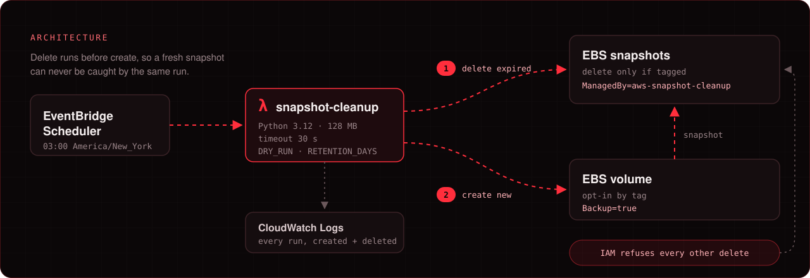
</p>

| Component | Setting | Why |
|---|---|---|
| **Lambda** | Python 3.12 · 128 MB · **30 s timeout** | The default is 3 s, and EC2 API calls can take longer |
| **Schedule** | EventBridge Scheduler · `cron(0 3 * * ? *)` · America/New_York | 3 AM local, not 3 AM UTC, and it follows daylight saving |
| **Volume selection** | Tag `Backup=true` | Opt-in. Nothing gets backed up unless someone tagged it |
| **Snapshot ownership** | Tag `ManagedBy=aws-snapshot-cleanup`, added at creation | How the function recognizes its own snapshots |
| **IAM role** | Least privilege, two conditions | The safety rule doesn't depend on the code being right |
| **Retention** | `RETENTION_DAYS` env var, default `7` | Changeable without a redeploy |
| **Dry run** | `DRY_RUN` env var | Shows what would happen before letting it happen |

```
lambda_function.py                    the function
policies/lambda-snapshot-policy.json  IAM inline policy on the Lambda's role
assets/                               diagrams
screenshots/                          evidence from every test (cropped)
screenshots/full/                     the same screenshots, uncropped
```

<br>

## ◆ The safety design

Deletion automation should fail safe. This one enforces *"only delete your own
snapshots"* twice:

**1 · In the code.** `delete_expired_snapshots()` only lists snapshots owned by
this account **and** tagged `ManagedBy=aws-snapshot-cleanup`. Anything else is
never considered.

**2 · In IAM.** The role can only call `ec2:DeleteSnapshot` on snapshots with
that tag, and can only add tags **while creating** a snapshot. So it can't tag
a stranger's snapshot to make it look like its own.

```json
{
  "Sid": "DeleteOnlyOwnSnapshots",
  "Effect": "Allow",
  "Action": "ec2:DeleteSnapshot",
  "Resource": "*",
  "Condition": {
    "StringEquals": { "ec2:ResourceTag/ManagedBy": "aws-snapshot-cleanup" }
  }
},
{
  "Sid": "TagOnlyAtCreation",
  "Effect": "Allow",
  "Action": "ec2:CreateTags",
  "Resource": "arn:aws:ec2:*:*:snapshot/*",
  "Condition": {
    "StringEquals": { "ec2:CreateAction": "CreateSnapshot" }
  }
}
```

> [!IMPORTANT]
> Without the second condition, the first one is decorative. A role that can
> tag anything can tag anything as deletable.

The function also **deletes before it creates**, so a snapshot made in a run
can never be caught by that same run's cleanup.

<details>
<summary><b>Screenshot — the policy as deployed</b></summary>
<br>
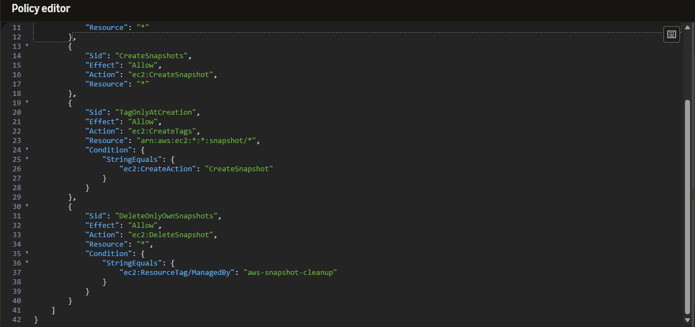
</details>

<br>

## ◆ The decoy test

The account held three snapshots, and only one of them belonged to the
function:

| Snapshot | Created by | `ManagedBy` tag? | Result |
|---|---|:---:|:---:|
| `snap-07def9edf5f72d922` | this Lambda | ✅ | 🟥 **deleted** |
| `snap-0a67bb40b01dc4a91` | by hand, `manual-do-not-delete` | — | 🟩 **kept** |
| `snap-0d5a3f7a64fd1a074` | an AMI from an earlier project | — | 🟩 **kept** |

Retention was set to **`0` days**, so *every* snapshot counted as expired.
The only thing standing between the decoys and deletion was the tag filter.

**Step 1 — dry run.** It listed exactly one snapshot for deletion.

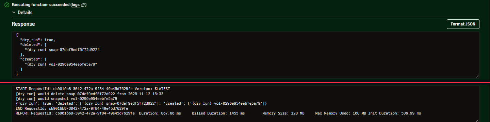

**Step 2 — real run.** It deleted that one and created tonight's replacement.

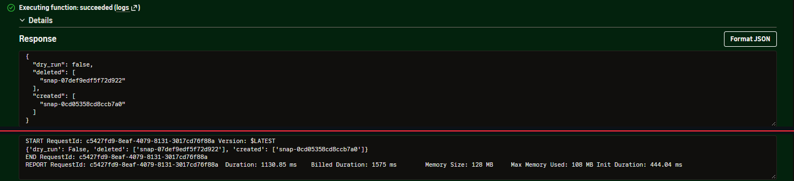

**Before** — three snapshots, all past a 0-day retention window:

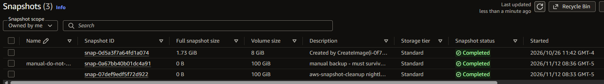

**After** — `snap-07def…` is gone, `snap-0cd05…` replaced it, and both decoys are untouched:

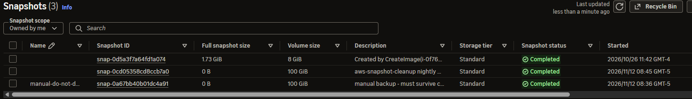

Retention was then set back to 7 days.

<details>
<summary><b>Earlier runs — first dry run, first real snapshot, auto-tagging</b></summary>
<br>

The first-ever run was a dry run. It found the tagged volume, which confirmed
the tag, the region, and the IAM read permissions in one response:

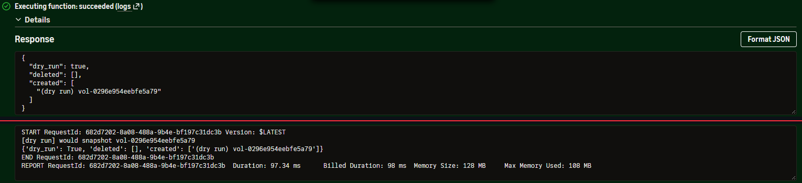

The first real run created a snapshot:

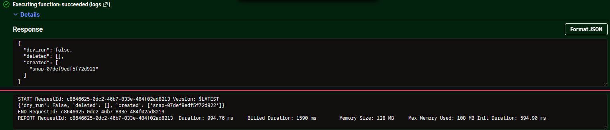

The function tagged it at creation. Nobody added these by hand:

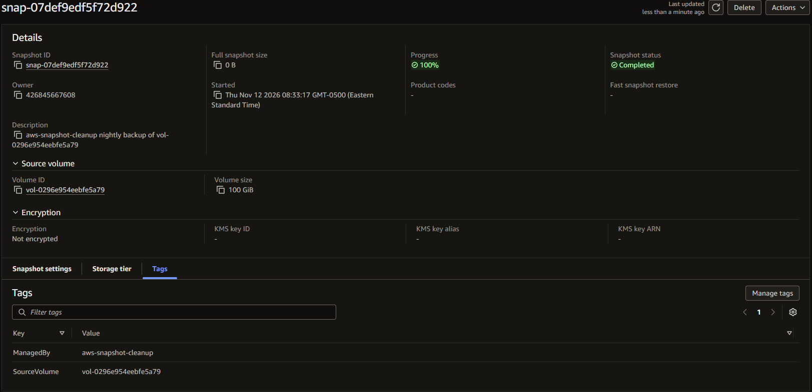
</details>

<details>
<summary><b>The schedule</b></summary>
<br>
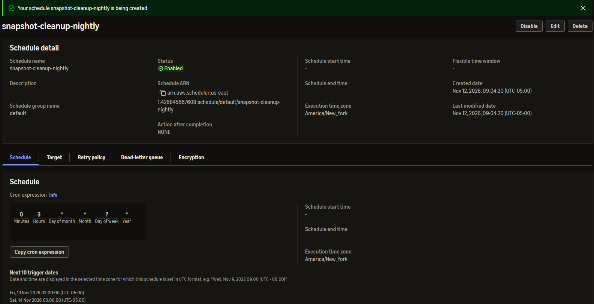
</details>

<br>

## ◆ Things I ran into

None of these were dramatic, but every one would have produced a tool that
*looked* like it worked and didn't.

| Snag | What it would have caused | Fix |
|---|---|---|
| Tag key typed as `backup` | Runs every night, finds zero volumes, reports success, **backs up nothing** | Tag keys are case-sensitive. Caught before the first run |
| Volume size defaulted to **100 GiB** — twice | ~$6/month for an empty disk. EBS volumes can't be shrunk | New 1 GiB volume, tags moved over |
| Console search for "volume" opened **Storage Gateway** | A different product that needs an on-prem gateway | EBS volumes live under EC2 |
| Region picker showed padlocks on every region | Building in the wrong region means the function never sees the volume | IAM is global and locks the picker. It unlocks on Lambda |
| Test event body was empty | Console refuses to invoke | `{}` is enough. The function ignores the event |
| Log said `13:33` for an `08:33` snapshot | Looks like the job ran at the wrong time | AWS logs in UTC. Not a bug, but it's how you misread a log |

> [!TIP]
> A tag-driven tool's most likely failure is **silent**. It doesn't crash, it
> just quietly does nothing. That's why the first run here was a dry run that
> printed what it found.

<br>

## ◆ Observations

- **An empty 100 GiB volume's snapshot is 0 B.** EBS snapshots store only
  blocks that have been written, and each later snapshot stores only what
  changed. You pay for changed data, not volume size × snapshot count.
- **Deleting a volume doesn't delete its snapshots.** They're stored
  independently, which is what makes them backups. The decoy outlived its
  volume.
- **Config changes cause cold starts.** Saving environment variables replaces
  the execution environment, so the next run added ~450–900 ms of
  `Init duration` on top of a ~1 s run.

<br>

## ◆ What I'd change in production

- **Test the IAM rule in the deny direction.** These tests prove the code's
  filter works, and that IAM *allows* deleting a tagged snapshot. The stronger
  proof is assuming the role and calling `DeleteSnapshot` on the decoy
  directly, expecting `UnauthorizedOperation`.
- **Make failures loud.** Right now a failed run only shows up in CloudWatch
  Logs. A CloudWatch alarm on the Lambda `Errors` metric to SNS, plus a
  dead-letter queue on the schedule, would make a missed backup impossible to
  miss.
- **Skip snapshots still pending** instead of erroring on them.
- **Copy to a second region.** Same-region snapshots don't survive a regional
  outage.
- **Compare against managed options first.** Amazon Data Lifecycle Manager and
  AWS Backup both do scheduled EBS snapshots with retention natively. Building
  it by hand was the point here. In production I'd start with DLM and only
  write custom code for rules it can't express.
- **Define it in code.** Terraform or CloudFormation, so the tag filter, the
  IAM conditions, and the timeout are reviewable instead of clicked.

<br>

## ◆ Cost & teardown

| Resource | Cost |
|---|---|
| Lambda — one ~1 s run per night | Free tier |
| EventBridge Scheduler — one run per night | Free tier |
| EBS volume — 1 GiB gp3 | Free tier (30 GB) |
| EBS snapshots | ~$0.05/GB-month of *changed* data. This volume's are 0 B |
| **Total** | **≈ $0/month** |

<details>
<summary><b>Teardown order</b></summary>
<br>

1. EventBridge → Scheduler → delete `snapshot-cleanup-nightly`
2. Lambda → delete `snapshot-cleanup`
3. IAM → delete `snapshot-cleanup-lambda-role`
4. EC2 → Snapshots → delete any tagged `ManagedBy=aws-snapshot-cleanup`
5. EC2 → Volumes → delete the test volume
</details>

<br>

<p align="center">
  <sub>Part of <a href="https://github.com/ArchitectKeita">ArchitectKeita</a>'s AWS portfolio · Project 01: <a href="https://github.com/ArchitectKeita/aws-ha-web-tier">aws-ha-web-tier</a></sub>
</p>
